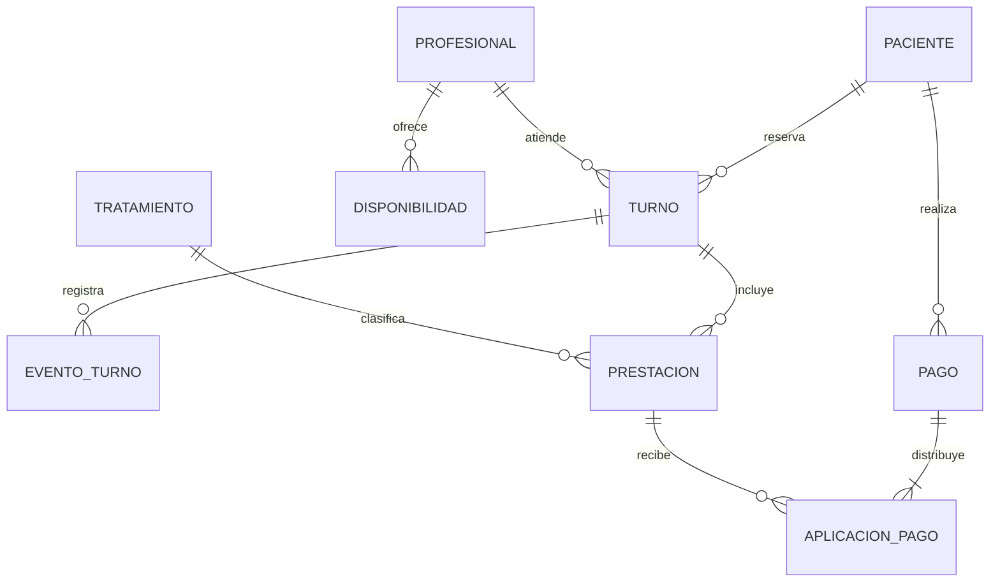

# 02 · De la hoja de recepción a PostgreSQL

**Objetivo.** Diseñar una base en la que una consulta pueda seguir un peso desde el recibo hasta la prestación que financió. Prepará tres entregables propios: un diagrama, un diccionario de campos y una lista de reglas con ejemplos aceptados y rechazados.

## 1. Encontrá las unidades de registro

Supongamos que TUR-01 tiene una limpieza y un control. Una planilla que repite el turno para mostrar ambos tratamientos alcanza para leer la atención. Si copiás también el importe completo del recibo a ambas filas, al sumar duplicás la caja. Marcá con colores tres hechos distintos en esa planilla: la asistencia, el trabajo realizado y el dinero recibido. Cada color te ayuda a descubrir una tabla.

En el **modelo conceptual**, dibujá los objetos y las relaciones en lenguaje cotidiano. En el **lógico**, definí qué identifica una fila, cuántas puede haber de cada lado y qué campos dependen de esa clave. En el **físico**, elegí tipos de PostgreSQL, restricciones e índices de acuerdo con los filtros de tus consultas.

## 2. Borrador de diccionario lógico

PK identifica una fila. FK apunta a una fila de otra tabla. Un campo opcional admite un valor nulo cuando la ausencia tiene sentido. Los nombres siguientes son propuestas para que dibujes y discutas tu propio esquema.

| Tabla / una fila representa | Identidad y relaciones | Datos mínimos y regla ilustrativa |
| --- | --- | --- |
| paciente / una persona ficticia | PK paciente_id | Fecha de alta. Identificador estable aunque cambie el alias. |
| profesional / un integrante de la agenda | PK profesional_id | Alias interno y fecha de alta. Conservar turnos pasados al desactivarlo. |
| tratamiento / un tipo de servicio | PK tratamiento_id | Descripción y precio de referencia. El precio histórico se guarda con la prestación. |
| disponibilidad / un bloque habilitado | PK bloque_id, FK profesional_id | Inicio y fin disponibles. Para este caso, un profesional atiende un sillón a la vez. |
| turno / una reserva | PK turno_id, FK paciente_id y profesional_id, FK opcional turno_anterior_id a turno | Creado en, inicio y fin previstos, estado actual y última actualización. Una reprogramación crea otra reserva vinculada. |
| evento_turno / una transición de estado | PK evento_id, FK turno_id | Estado nuevo, instante efectivo, instante registrado y versión de origen. Distingue la fecha del hecho de cuándo se conoció. |
| prestacion / una unidad realizada | PK prestacion_id, FK turno_id y tratamiento_id | Fecha de prestación y precio final en ARS. Dos unidades del mismo servicio llevan IDs distintos. |
| pago / un recibo | PK pago_id, FK paciente_id | Fecha de cobro, medio e importe recibido en ARS. Un recibo puede cubrir varias prestaciones del mismo paciente. |
| aplicacion_pago / una imputación | PK compuesta pago_id + prestacion_id, ambas FK | ARS asignados a ese par. Un recibo se imputa completamente en la fecha de cobro según el alcance inicial. |
| gasto / un egreso efectivamente pagado | PK gasto_id | Categoría, fecha de pago e importe. Se analiza por la fecha de salida de caja. |
| lote / una versión de entrega | PK lote_id, identidad de origen y huella | Fuente, contrato, recepción y controles declarados. Una misma entrega admite varios intentos. |
| ejecucion / un intento de procesar un lote | PK ejecucion_id, FK lote_id | Inicio, fin, estado, conteos y versión de las reglas. Conservá los intentos fallidos. |
| rechazo / una fila observada en un intento | PK rechazo_id, FK ejecucion_id | Archivo, hoja o número de fila, clave original si existe y motivo. Debe permitir volver a la fuente. |

Acompañá las tablas operativas con referencias de origen y revisión para identificar el lote que aportó cada cambio. Cuando un registro tenga varias revisiones, conservá en la capa intermedia las versiones anteriores y su vínculo con el intento de carga.

## 3. Dibujá las relaciones difíciles

Una prestación puede existir con cero cobros. Una vez aceptado en la base, cada pago debe tener una o más aplicaciones. La tabla intermedia convierte la relación muchos-a-muchos entre pagos y prestaciones en dos relaciones uno-a-muchos. La FK de reprogramación enlaza una reserva nueva con la cancelada. Para esta versión, conservá el horario original y creá otro ID cada vez que cambie.

**Normalización en este caso.** Si escribís el nombre del servicio junto a cada cobro, corregir su ortografía exige editar muchas filas. Ponelo en el catálogo y referencialo por clave. El precio final de una prestación sí depende de esa atención concreta: guardalo allí para que un cambio en la lista de precios no reescriba meses cerrados.

## 4. Pasá a las reglas físicas

| Decisión en PostgreSQL | Ejercicio de diseño | Ejemplo que debería detectar |
| --- | --- | --- |
| Tipos y nulabilidad | Texto para códigos con ceros, decimal exacto para ARS, fecha para egresos a nivel día, fecha-hora con zona para eventos y reservas. | PAC-001 conserva los ceros y 10.000,25 conserva centavos. |
| PK, FK y unicidad | Definí los campos únicos por fuente y su equivalencia con la identidad de negocio. Preservá las relaciones históricas al dar de baja un maestro. | Una aplicación que apunta a una prestación inexistente queda observada. |
| Reglas dentro de una fila | Importe de pago y aplicación mayor que cero. Precio de prestación mayor o igual a cero. Fin posterior al inicio. Enumerá estados admisibles. | Un pago de cero o un intervalo invertido falla. |
| Reglas entre filas | Verificá en una misma transacción que cada recibo se reparta completo, que el paciente coincida y que el acumulado aplicado no supere la prestación. | Dos cuotas aceptables por separado pueden exceder el precio al sumarse. |
| Capacidad de la agenda | Impedí solapamientos simultáneos de reservas activas para un mismo profesional. Las canceladas liberan horario. Validá que cada turno atendido esté dentro de la disponibilidad. | TUR-03 cancelado y TUR-04 atendido pueden compartir horario. Dos atendidos superpuestos requieren revisión. |
| Índices | Proponé índices para búsquedas frecuentes por profesional/fecha, por fecha de cobro y por las FK usadas en cruces. Contrastá el plan y el tiempo en un conjunto con volumen. | Explicá por qué cambia o se mantiene el plan en una consulta de seis meses. |

Para un control que exige leer otras filas, decidí dónde garantizarlo y qué ocurre si dos cargas intentan aceptar pagos al mismo tiempo. Un control por fila no puede garantizar por sí solo la suma de varias aplicaciones. [Restricciones de PostgreSQL](https://www.postgresql.org/docs/current/ddl-constraints.html)

## 5. Escribí tu diccionario campo por campo

| Tabla y campo de ejemplo | Tipo lógico y unidad | Obligatorio | Fuente y significado | Validación |
| --- | --- | --- | --- | --- |
| prestacion.precio_final | Decimal exacto, ARS con 2 decimales | Sí | Gabinete, valor acordado el día de la prestación | Mayor o igual a cero. Un valor faltante va a revisión. |
| turno.turno_anterior_id | Identificador de turno | Solo en reprogramaciones | Recepción, reserva que fue reemplazada | Turno existente, anterior y del mismo paciente. |
| evento_turno.registrado_en | Fecha y hora con zona | Sí | Agenda, primer instante en que la novedad estaba disponible | Conservar aun si la entrega llegó más tarde. |

Copiá el formato y completalo para tus tablas. Ensayá dos historias con el diagrama: un turno cancelado sin cobro y una visita con varias prestaciones y pagos parciales. Tenés una primera versión defendible cuando puedas recorrer ambas historias y explicar dónde se guarda cada dato.
